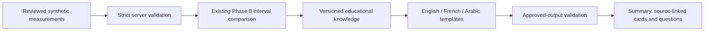

# Phase 9 — Grounded multilingual report explanations

The Patient Portal now supports **Upload → Extract → Review → Explain** at
<http://127.0.0.1:3000/patient/reports>. This is a synthetic educational workflow,
not a diagnostic system. It explains only structured measurements whose
transcriptions the user confirmed. It does not use the heart disease model.

## Audit and implementation plan

Before application changes, the audit read FastAPI startup/routes, errors and
privacy middleware; Phase 8 extraction, parser, schemas, educational definitions,
measurement identifiers and interval semantics; review state and controls; the
typed API client; frontend/backend tests and project documentation. No applicable
AGENTS.md was found. Both existing loopback servers were running. The backend was
restarted once after changes; the frontend instance was reused. No duplicate
servers, dependency upgrades, model fitting or additional infrastructure were needed.

Executed baseline: **145 Python tests**, **73 frontend unit tests**, **21 browser
tests** passed. Python had one existing upstream Starlette/AnyIO deprecation
warning. The plan was to add strict reviewed-fact schemas, reuse the Phase 8
comparison, render curated translations, validate output and add a separate UI
section, then verify regressions and preservation. This extends the existing
architecture rather than replacing the parser or workspaces.

## Architecture



Facts stay language independent. The interval relationship is calculated from
reviewed numbers, units and explicit inclusive/exclusive bounds by the existing
`compare_interval` function. No source text, instructions from documents, inferred
reference ranges, numerical unit conversions, classifier scores or SHAP values
enter the explanation engine.

| Created file | Purpose |
| --- | --- |
| `app/schemas/report_explanations.py` | Strict bounded request/response contracts, supported-name resolution, numeric/range/unit/identifier validation. Reuses the Phase 8 interval base and comparison type without modifying them. |
| `app/api/routes/report_explanations.py` | Independent JSON endpoint dispatched by FastAPI's sync-route thread pool. |
| `app/services/laboratory_knowledge.py` | Project-authored French/Arabic definitions and three-language templates; reuses the English catalogue and NLM source URLs. |
| `app/services/explanation_providers/base.py` | Provider protocol accepting only reviewed structured facts. |
| `app/services/explanation_providers/deterministic.py` | Counts, existing interval comparison and curated language rendering. Decimal points, units and source IDs are preserved. |
| `app/services/explanation_providers/__init__.py` | Package marker. |
| `app/services/explanation_validation.py` | Checks schema, byte bound and exact equality with approved facts and language; rejects unapproved additions. |
| `app/services/explanation_engine.py` | Revalidates service input, orchestrates generation, and safely falls back when an injected provider fails or contradicts approved output. |
| `tests/test_report_explanations.py` | Strict input, multilingual grounding, provider/fallback and compatibility tests. |
| `frontend/src/types/reportExplanations.ts` | Typed request and bounded Zod response validation. |
| `frontend/src/utils/reportExplanation.ts` | Checks returned IDs, values, units, intervals, comparisons, correction flags and counts against the submitted snapshot. |
| `frontend/src/components/patient/ReportExplanation.tsx` | Explicit explanation action, language selector, overview, cards, references, questions and limitations. |
| `frontend/src/components/patient/ReportExplanation.test.tsx` | UI/client tests including cancellation, stale replies, edits and clearing. |
| `frontend/src/test/fixtures/report-explanation-{en,fr,ar}.json` | Actual endpoint responses for one invented reviewed measurement, used as contract fixtures. |
| `frontend/e2e/report-explanations.spec.ts` | Actual PDF-to-explanation browser workflow across three viewport sizes. |

Modified backend files: `app/main.py` initializes/registers the independent
engine/router; `app/core/security.py` permits at most 64 KiB for this JSON endpoint
while retaining the previous limits elsewhere; `app/core/exceptions.py` returns
sanitized actionable explanation validation errors. `tests/api/test_api_health.py`
updates the additive route count from seven to eight; existing cases remain.

Modified frontend files: `MeasurementReview.tsx` supplies confirmed corrected
facts and stable row anchors; `ReportUpload.tsx` labels step four Explain;
`services/api.ts` adds the typed JSON call and safe error handling; `styles.css`
adds neutral responsive cards and RTL presentation. Existing educational term
definitions remain available beneath the new section.

Updated documentation: the root and frontend READMEs, Phase 8 extraction guide,
multi-workspace guide and project status. Local preservation/OpenAPI/verification
records are under ignored `reports/metrics/phase9*` and
`reports/metrics/medical_report_explanation_verification.json`.

## Providers and validation

`DeterministicExplanationProvider` is the only configured implementation. It works
offline with no keys, downloads or runtime medical-source retrieval. The UI says
“Educational explanations generated from reviewed measurements and predefined
medical information” and “No language model used.” AI-assisted is the feature
title; the actual generation method is always `deterministic`.

No Ollama, llama-server or LM Studio command or listening Ollama service was found
during the local audit. No local LLM adapter, external provider, model settings,
model installation or model generation is implemented or claimed. The request
cannot choose a provider. A protocol and test injection seam support future work;
that seam is not a working LLM integration.

The engine creates an approved deterministic response first. Injected provider
output must match that response exactly, including text, counts, references,
numbers and units. A keyword filter cannot prove a medical paraphrase correct,
so arbitrary rewrites are deliberately rejected. Exceptions, including a reported
provider timeout, or invalid output produce the approved response with
`fallback_used=true` and a localized warning. If deterministic generation itself
fails, the service returns sanitized HTTP 503 and the UI displays no explanation.
There is no potentially slow local-model call in the configured execution path.

Generation is bounded by 50 measurements, finite quantities, short fields,
fixed templates, and a 384-KiB output check. The frontend request timeout is
20 seconds. Cancellation and version guards prevent stale responses from being
displayed; browser cancellation does not guarantee server work stops instantly.
Any future untrusted local provider would need real process/time controls before
being enabled; the protocol alone does not provide them.

## Supported measurements and grounding

All nine Phase 8 analytes are supported: hemoglobin, glucose, total cholesterol,
HDL, LDL, triglycerides, white blood cell count, platelet count and creatinine.
Exact existing English names and documented aliases resolve to these keys.
Unknown corrected names are rejected rather than given an invented definition.
Duplicate analytes are allowed with distinct identifiers; duplicate IDs are rejected.

The following NLM MedlinePlus pages were checked on 2026-10-20 for general
educational definitions: [Hemoglobin](https://medlineplus.gov/lab-tests/hemoglobin-test/),
[Blood glucose](https://medlineplus.gov/lab-tests/blood-glucose-test/),
[Cholesterol](https://medlineplus.gov/lab-tests/cholesterol-levels/),
[White blood count](https://medlineplus.gov/lab-tests/white-blood-count-wbc/),
[Platelets](https://medlineplus.gov/lab-tests/platelet-tests/), and
[Creatinine](https://medlineplus.gov/lab-tests/creatinine-test/).
The links support definitions, not a medical conclusion about a demonstration
value. The invented printed intervals are not attributed to these sources.
French/Arabic translations are authored for this project, not official NLM
translations or professionally certified medical translations. Knowledge version:
`lab-education-1`.

## API contract

**POST `/api/v1/reports/explain`**, JSON only. Swagger:
<http://127.0.0.1:8000/docs>. It does not accept PDFs/images or raw report text.

```json
{
  "synthetic_only": true,
  "language": "en",
  "measurements": [{
    "id": "measurement-1",
    "name": "Hemoglobin",
    "value": 11.2,
    "unit": "g/dL",
    "reference_range": {
      "lower": 12,
      "upper": 16,
      "lower_inclusive": true,
      "upper_inclusive": true,
      "unit": "g/dL"
    },
    "reviewed": true,
    "user_corrected": false
  }]
}
```

Every included row must have literal boolean `reviewed=true`. If any is
unreviewed, the entire request receives HTTP 422: confirm it or remove it before
retrying. The frontend excludes unreviewed rows and states how many are included.
The flag is a user assertion of transcription review, not authentication, clinical
approval or proof the original document was synthetic. `synthetic_only` must also
be literal boolean true. No server session links the request to an earlier upload.

Quantities and bounds must be finite JSON numbers from 0 through 1e9, or null
where unknown; strings and booleans are rejected. The bound is a parser resource
constraint, not a medical normal range. Measurement IDs must use the existing
`measurement-N` shape and be unique. Each request has 1–50 rows and language
`en`, `fr` or `ar`. Extra fields, excessive strings, malformed/reversed/empty
intervals, unsupported units and incompatible non-null result/reference units
are rejected. Normalization accepts existing notation variations but does not
convert quantities. Unit compatibility here means matching notation, not a
claim that a unit is clinically appropriate for the named test.

Use null for an absent interval; no interval is inferred. One-sided intervals
and exclusive bounds are supported. Missing values/units yield `not_evaluated`.
Omitting a reference unit does not cause it to be guessed from the result unit.
Optional `raw_text` is bounded and ignored for interpretation; the browser sends
only “User-reviewed bounds”, never the original snippet.

The response includes `language`, `generation_method`, `knowledge_version`,
`fallback_used`, all five counts, a localized `summary`, measurement explanations,
source-linked doctor questions, warnings and disclaimer. Each measurement keeps
its stable ID, source name, exact parsed number/unit, reviewed bounds, comparison,
correction flag and education URL. `source_measurement_ids` ties every card and
question to its reviewed input.

Example excerpt for the synthetic input above:

```json
{
  "language": "en",
  "generation_method": "deterministic",
  "fallback_used": false,
  "counts": {
    "reviewed": 1,
    "below_reported_interval": 1,
    "within_reported_interval": 0,
    "above_reported_interval": 0,
    "not_evaluated": 0
  }
}
```

Example educational text: “The value is below the printed reference interval.
A printed interval comparison alone does not establish a diagnosis.” All counts
and comparison labels come from the submitted facts, never hardcoded sample values.

Errors: 400 malformed JSON; 413 byte limit; 415 non-JSON; 422 invalid facts,
unreviewed rows, unsupported language/name/unit or identifiers; 503 deterministic
service unavailable. Bodies and exception details are not echoed.

## Frontend review, localization and temporary state

Upload a provided synthetic text PDF, extract it, correct any transcription,
and confirm a row. **Explain My Report** enables when at least one row is reviewed.
The report overview shows reviewed/below/within/above/not-evaluated counts with
neutral styling. Cards show value, unit, printed interval, comparison, definition,
educational context and correction origin. Source links jump back to the exact
review row; education links open the verified NLM page.

Choose English, Français or العربية. After generation, language changes issue a
new structured explanation request and preserve all review edits, values, units
and identifiers. No re-upload, extraction or OCR occurs. Before the first
explanation, choosing language makes no request. Arabic output has `lang=ar`,
RTL flow and isolated LTR value/unit/bound/source-ID displays. The surrounding
application controls remain English; this is localized explanations, not a
complete three-language application shell. Decimal points are not localized.

Any draft edit, reset or confirmation change remounts the explanation section,
aborts pending work and discards previous output. This intentionally resets the
explanation language choice to English as well, while keeping current review
drafts in the parent. Late replies cannot restore an outdated explanation.
Clear Report, leaving the report route or refresh removes report, review and
explanation component state. Language changes alone do not clear corrections.

## Privacy and safety boundaries

No database, patient profiles, localStorage/sessionStorage, analytics, cloud API,
external model call or document persistence was added. The existing local CORS
allowlist, no-store responses, sanitized errors and no-access-log launch remain.
The new endpoint receives a small subset of reviewed facts, not original files.
React renders text safely without executable HTML. Report uploads never trigger
classification or SHAP. Uploaded instructions cannot select templates/providers.

This is not production-ready clinical software or a healthcare compliance
certification. An acknowledgement cannot detect real patient information or
establish truth. Memory clearing is not secure zeroization. Sources explain terms,
not a person's health. No diagnoses, disease probabilities, treatment/medication
advice or emergency decisions are generated. No claim of health is inferred from
a within-interval value, and no disease is inferred from an outside-interval value.

## Verification and local execution

Use existing environments; no new dependencies were required. In PowerShell,
`npm.cmd` avoids a machine policy that blocks the npm PowerShell shim:

```powershell
cd C:\MedIntel-AI
.\.venv\Scripts\python.exe -m pytest -q
.\.venv\Scripts\python.exe -m pip check
# Only if port 8000 is not already serving this project:
.\.venv\Scripts\python.exe -m uvicorn app.main:app --host 127.0.0.1 --port 8000 --no-access-log

# Separate terminal; start dev only if port 3000 is not already serving:
cd C:\MedIntel-AI\frontend
npm.cmd run dev
npm.cmd test
npm.cmd run type-check
npm.cmd run lint
npm.cmd run build
npm.cmd run test:integration
npm.cmd run test:provenance
npm.cmd run test:browser
```

Actual results and preservation evidence are recorded in
`reports/metrics/medical_report_explanation_verification.json`. The test additions
cover all three languages and analytes, exact source/fact preservation, summary
counts, inclusive/exclusive boundaries, unknown facts, strict validation, provider
errors and rejected output. UI tests cover the explicit action, partial review,
language changes, RTL, safe errors, timeout, cancellation, stale replies, editing
and clearing. Browser tests use real synthetic PDF requests, corrected values,
three viewports, source navigation, Axe WCAG A/AA checks and route clearing.
Automated accessibility checks are not a full accessibility certification.

| Executed check | Final result |
| --- | --- |
| Python regression and new tests | 206 passed: 145 previous + 61 new; one existing upstream deprecation warning. |
| Frontend unit tests | 94 passed: 73 previous + 21 new. |
| Browser tests | 27 passed: 21 previous + 6 new, across desktop/tablet/mobile. |
| TypeScript, ESLint, changed-file Prettier check, production build | Passed. |
| Python dependency check | No broken requirements. |
| Original API smoke checks | Passed, including prediction, 28-feature SHAP reconstruction and CORS. |
| Model comparison provenance | All three rows and both frozen source hashes match. |
| Live explanation requests | HTTP 200 in English, French and Arabic; endpoint appears in Swagger/OpenAPI. |
| Preservation | 47 protected files unchanged; all seven prior OpenAPI paths and their component schemas unchanged. |

An initial browser run exposed a new test's incorrect small-screen navigation
selector. It was corrected using the existing Toggle navigation contract; the
targeted checks and complete final 27-test run passed. No application features or
existing test cases were removed to obtain these results. Desktop, tablet and
mobile widths were 1440, 768 and 390 pixels respectively. The production entry
bundle was 493.60 kB (152.54 kB gzip), with no chunk-size warning.

Existing Phase 8 tests, six original model endpoints, seven previous OpenAPI
contracts, research artifacts, classifier and SHAP remain regression targets.
No model or evaluation results are altered to satisfy tests.

## Known limitations and suggested Phase 10 work

Phase 8 layout/parser limits still apply. Tesseract remains unavailable on this
machine, so only text PDFs work end to end without additional setup. Phase 9 is
independent of OCR and works from reviewed structured facts. Translation and
educational accuracy require independent expert review before broader use.
Numbers represent parsed JSON quantities; original formatting precision is not
claimed. There is no open-ended assistant, local LLM or runtime retrieval.

After separate approval, Phase 10 could add a larger versioned synthetic
multilingual evaluation corpus, expert translation review, calibrated extraction
benchmarks and improved review ergonomics. A local LLM experiment would first
need installed approved weights, process/time limits and a defensible output
validation design. Production medical data would need its own privacy/security
and governance work. No Phase 10 implementation, deployment, commit or push
is included here.
