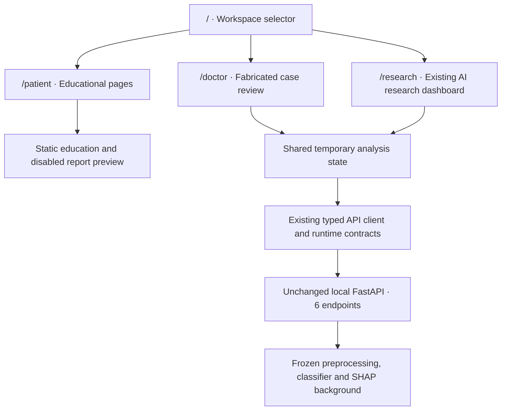

# MedIntel AI — Phase 7 multi-role platform

**Current Phase 9 update:** the Patient report route now adds an explicit Explain My Report action for confirmed synthetic transcriptions. Offline templates provide source-linked English/French/Arabic summaries, measurement explanations and questions, with Arabic RTL output. No language model is configured. `/api/v1/reports/explain` is independent of prediction, SHAP and OCR, and the seven previous endpoint contracts remain unchanged. See [Medical report explanations](medical_report_explanations.md). Phase 10 has not started. The Phase 7 account below and Phase 8 update are historical milestone records.

**Current Phase 8 update:** `/patient/reports` now implements a synthetic-only report explorer with bounded local extraction, optional local OCR, deterministic laboratory parsing and explicit manual review. The original six model/API contracts and Doctor/Researcher features are preserved. No patient prediction is added. Patient pages make no automatic model calls, but explicit synthetic report submission calls the new `/api/v1/reports/extract` endpoint. Text PDFs work; OCR-dependent files show a setup error because Tesseract is absent on this machine. See [Medical document extraction](medical_document_extraction.md). The Phase 7 record below is historical; its disabled-preview and no-upload descriptions apply to that milestone.

MedIntel AI now provides three local demonstration workspaces under one React application: **Patient Portal**, **Clinical Workspace**, and **AI Research Lab**. The root route is a workspace selector. Selection changes the interface; it is not authentication, authorization, professional verification or a security boundary.

No backend endpoints, model mathematics, Python dependencies, raw data, model artifacts or historical evaluations were changed. There is no document ingestion, OCR, LLM service, patient account, database or cloud deployment. Phase 8 has not started.

## Audit and plan

Before implementation, the audit inspected the entire `frontend/src/` file list, React Router configuration, layouts, styles, typed API contracts/client, form and SHAP flow, existing unit and browser tests, FastAPI startup code, live OpenAPI and previous documentation. Both existing services were already running on loopback. No duplicate servers were started. No `AGENTS.md` was found in the inspected parent/project locations.

Baseline verification was run before changing application code: **34 frontend tests**, **6 browser tests**, and **97 Python tests** passed. Python retained one upstream Starlette/AnyIO deprecation warning. Preservation fingerprints were recorded for **42 files**: all four notebooks, Python research/backend modules, dataset, pipeline and prior metric/report artifacts. Earlier frontend tests were retained, with the research entry path updated from `/` to `/research`.

The implementation plan was to add a global selector and shared workspace navigation, build static patient education and a disabled report preview, reuse the existing clinical/research analysis flow, add verified model comparisons, then validate preservation, API compatibility, responsiveness and accessibility. Existing components and dependencies were reused instead of creating another application.

## Architecture



`PlatformLayout` supplies the public header, workspace picker, skip link and footer. The existing `AppLayout`, `Sidebar` and `Header` are reused for all workspaces, driven by the centralized definitions in `src/utils/workspaces.ts`. Patient pages have larger reading text and simpler language; Doctor pages use grouped structured inputs; Research preserves analytical charts and methodology.

The **Patient routes and landing page are outside `ResearchProvider`**. They do not initialize model state, poll availability, request predictions or contact the API. Doctor and Researcher routes share one provider so a fabricated case can be explored from both perspectives. This state is only browser memory. Switching to Patient or the landing page unmounts the provider, cancels pending client requests and clears the draft/results. Refreshing also clears it. Cancelling a client request cannot guarantee server-side work has not already started; the existing backend does not persist request bodies.

There are no localStorage/sessionStorage writes or third-party analytics. Workspace selection does not hide or protect API routes from a determined caller; no role-based authorization is claimed.

## Routes and user journeys

| Route | Implemented behavior |
| --- | --- |
| `/` | Platform introduction, three workspace cards, global selector and non-diagnostic notice. |
| `/patient` | Welcoming educational overview, report preview link, learning link and privacy notice. |
| `/patient/reports` | Disabled upload design with planned demonstration PDF/PNG/JPG formats; no accepted files, file input, upload handler, extraction or transmission. |
| `/patient/learn` | Four sourced educational cards: hemoglobin, glucose, cholesterol and blood pressure; general conversation questions. |
| `/patient/about` | Educational scope, privacy boundaries and future requirements. |
| `/doctor` | Clinical demonstration overview, credential/access limitation, model availability and case/reference links. |
| `/doctor/cases` | Existing 13-feature form, grouped clinical presentation, fabricated example and experimental result card. |
| `/doctor/clinical-variables` | Current API-supplied descriptions, categories, units, supported ranges and null rules. |
| `/doctor/explainability` | Existing individual SHAP flow using the exact latest validated case. |
| `/doctor/about` | Experimental limitations, fabricated-only scope, and explicit absence of clinician verification. |
| `/research` | Preserved overview, historical dataset counts, selected model and live API readiness. |
| `/research/predict` | Preserved prediction form and results. |
| `/research/models` | Verified five-fold results for all three candidate models; selected model's held-out metrics displayed separately. |
| `/research/experiments` | Read-only historical split, selection and evaluation design. No experiment execution or training action. |
| `/research/explainability` | Preserved signed contributions, top features, baseline, reconstruction check, log-odds chart and full table. |
| `/research/methodology` | Preserved dataset, target, preprocessing, metrics, limitations and artifact provenance. |

Legacy `/predict`, `/explainability` and `/model` routes use React Router `Navigate` with `replace` to reach their research equivalents. Root `/` intentionally changes to the requested selector; the former overview is `/research`. Unknown paths show a not-found page with a workspace selection link. Browser history, direct local URLs and the existing Vite SPA fallback work with these routes.

Patient journey: choose Patient → read a general explanation or view the disabled preview → follow source links or prepare a question. There is no patient assessment form or experimental disease prediction action.

Doctor journey: choose Clinical Workspace → review the demonstration limitation → enter a fabricated case → validate the 13 features → inspect the experimental classification and uncalibrated score → request SHAP → review signed log-odds contributions. Updating inputs preserves stale-result warnings and requires a matching new prediction.

Researcher journey: choose Research Lab → examine historical metrics → compare training-only model results → review experiment design and limitations → use the original prediction and SHAP workflows. The same temporary case can be examined across Doctor and Researcher until leaving for Patient/the selector or refreshing.

## Important files and reuse

| File | Responsibility |
| --- | --- |
| `frontend/src/App.tsx` | Public/static routes, shared analysis provider boundary, workspace routes, legacy redirects and explanation lazy loading. |
| `src/utils/workspaces.ts` | Workspace descriptions, icons, canonical navigation and context-specific prediction/explanation links. |
| `components/layout/PlatformLayout.tsx` | Landing/public shell and page title. |
| `components/layout/WorkspaceSwitcher.tsx` | Native accessible selector; navigates without creating an identity/session. |
| `components/layout/AppLayout.tsx`, `Sidebar.tsx`, `Header.tsx` | Reused shell, active links, workspace title, mobile drawer, keyboard focus and analysis-only backend status. |
| `pages/patient/` | Educational home, reports preview, learning and privacy pages. |
| `components/patient/` | Report design preview, reusable education cards and patient safety notice. |
| `src/data/healthEducation.ts` | Short checked educational summaries and direct NLM MedlinePlus citations. |
| `pages/doctor/` | Clinical overview, backend-supplied variable reference and scope page. |
| `components/prediction/PatientForm.tsx` | Existing shared research form; its historical filename is retained. Doctor mode adds four fieldsets and tooltips without changing validation or payload semantics. It is not mounted in the Patient workspace. |
| `components/ui/InfoTooltip.tsx` | Focus/hover/click-accessible schema definitions, with Escape dismissal. |
| `pages/PredictionPage.tsx` | Reused case/prediction page with a clinical presentation option. |
| `pages/DashboardPage.tsx`, `ModelInfoPage.tsx`, `ExplainabilityPage.tsx` | Preserved research views and SHAP components; navigation points to workspace-specific destinations. |
| `pages/research/ResearchModelsPage.tsx` | Read-only verified cross-validation comparison with a separately labeled API holdout chart. |
| `pages/research/ResearchExperimentsPage.tsx` | Read-only historical experiment design. |
| `src/data/researchComparison.json` | Aggregate Phase 3 CV snapshot, source CSV SHA-256 and experiment JSON SHA-256; no individual records. |
| `scripts/verify-research-snapshot.mjs` | Verifies both source hashes and exact equality of all model rows to the original experiment manifest. |
| `src/Platform.test.tsx` | New workspace, privacy, contract reuse, state lifecycle, redirects and navigation tests. |
| `e2e/workspaces.spec.ts` | Live patient/doctor/research flows, API isolation, state clearing, source links, browser console, responsiveness and Axe checks. |

The existing API client, Zod contracts, `ResearchContext`, payload validation, SHAP mathematics, charts and numerical reconstruction checks are reused. No dependency versions were changed. Existing test cases were retained; the old overview test entry path was adapted to `/research`.

## Backend and research provenance

All six Phase 5 endpoints remain byte-for-byte compatible in the live OpenAPI comparison. No backend file changed. Readiness, model metadata and input schema still come from the existing service; numeric limits remain training support, not medical normality. Original `thal` remains the source thallium-test code, not a thalassemia diagnosis. Explicit nulls use frozen training-fitted imputation, and blank/all-null/unsupported inputs remain invalid under existing rules.

`researchComparison.json` copies aggregate results from `reports/metrics/cv_summary.csv`, verified exactly against `reports/metrics/experiment.json`. Its source hashes make manual changes detectable with `npm run test:provenance`. It does not load a dataset or recompute an evaluation. Only the selected Logistic Regression has historical held-out results; Random Forest and XGBoost are shown with training-only cross-validation means and sample SDs. The UI never invents holdout results for the alternatives or new usage statistics.

The existing API smoke check verifies all six endpoints, OpenAPI keys, CORS preflight, matching prediction/explanation score, 28 SHAP contributions and sigmoid reconstruction. A fabricated example still produces class 1 and score approximately **0.5591060694**. This is a demonstration observation, not a clinical finding.

Patient summaries were checked against official National Library of Medicine sources on 2026-10-20 and link directly to them: [Hemoglobin test](https://medlineplus.gov/lab-tests/hemoglobin-test/), [Blood glucose test](https://medlineplus.gov/lab-tests/blood-glucose-test/), [Cholesterol levels](https://medlineplus.gov/lab-tests/cholesterol-levels/), and [Measuring blood pressure](https://medlineplus.gov/lab-tests/measuring-blood-pressure/). They explain general concepts without assigning a condition or interpreting a submitted value. No reference-range thresholds or personal treatment recommendations are generated.

## Local development and checks

The existing servers were reused: frontend <http://127.0.0.1:3000>, backend <http://127.0.0.1:8000>, Swagger <http://127.0.0.1:8000/docs>. Both bind to loopback. No deployment, commit or push was performed.

When restarting, use two terminals and do not start a duplicate instance:

```powershell
cd C:\MedIntel-AI
.\.venv\Scripts\python.exe -m uvicorn app.main:app --host 127.0.0.1 --port 8000 --no-access-log
```

```powershell
cd C:\MedIntel-AI\frontend
npm ci
npm run dev
```

The optional ignored `frontend/.env.local` can set `VITE_API_BASE_URL=http://127.0.0.1:8000`; `.env.example` provides the public default. Vite environment values are public browser configuration, never credentials. Existing explicit CORS origins already include port 3000; no security setting was weakened.

```powershell
cd C:\MedIntel-AI\frontend
npm run type-check
npm run lint
npm test
npm run build
npm run test:integration
npm run test:provenance
npm run test:browser

cd C:\MedIntel-AI
.\.venv\Scripts\python.exe -m pytest -q
```

Unit tests mock the API and need no running services. Provenance verification needs the original local Phase 3 report artifacts, which are ignored by Git; missing reports produce a controlled failure. Browser tests require both servers and the installed Microsoft Edge used by the existing Playwright configuration. Test data is fabricated; screenshots and reports are ignored. Private input values should never be used in tests or traces.

## Verification record

| Check | Baseline | Phase 7 |
| --- | --- | --- |
| Frontend unit tests | 34 passed | 51 passed; all 34 earlier cases retained plus 17 new cases. |
| Browser tests | 6 passed | 15 passed across desktop 1440×1000, tablet 768×1024 and mobile 390×844. |
| Python tests | 97 passed, 1 existing warning | 97 passed, same existing warning. |
| TypeScript / ESLint | Existing configuration inspected | Passed without type or lint errors. |
| Production build | Existing scripts preserved | Passed with separate entry/chart/explanation chunks. |
| API schema | Six live endpoints recorded | Exact OpenAPI match; endpoint behavior checked by the existing smoke script. |
| Historical metrics | Original Phase 3 sources inspected | Snapshot source hashes and every model row match. |
| Protected artifacts | 42 SHA-256 fingerprints recorded | All 42 unchanged. |

Browser workflows check absence of errors/warnings, responsive overflow, visible disclaimers, labeled controls, source links, active navigation, disabled uploads, no patient API calls or browser persistence, clinical prediction/SHAP, state clearing and legacy redirects. Axe checks WCAG A/AA rules on tested pages and states. Automated checks do not constitute a complete accessibility or clinical validation assessment. Existing runner `NO_COLOR`/`FORCE_COLOR` messages and the upstream Python deprecation warning are retained and not hidden.

## Limits and Phase 8 preparation

The workspace selector offers different views, not separate protected accounts. No credential verification, authorization, secure patient storage, or medical record access exists. Manual case inputs are intended for fabricated demonstrations only. Scores remain uncalibrated; SHAP uses positive-class log-odds and does not establish causation. Small historical cohort size, earlier full-cohort EDA and lack of external validation remain material research limitations. The model must not support clinical decisions.

The report preview says **“Coming in Phase 8 — Demonstration documents only.”** This is a planned scope label, not an implemented capability. Before any later demonstration document phase, agree on document licensing, synthetic-only examples, input limits, extraction evaluation, retention/deletion behavior and validation of extracted values. Real medical documents would additionally require authentication, authorization, secure storage, privacy review and applicable regulatory assessment. No OCR or external AI services are connected now.

Phase 7 ends here. Phase 8, real document processing, public deployment, commits and pushes require the user's separate approval.
